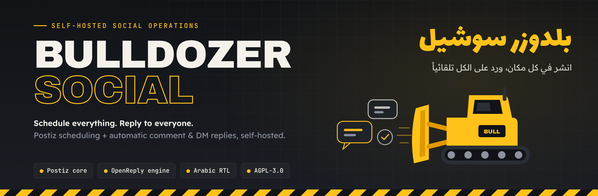

<p align="center">
  
</p>

<p align="center">
  <a href="LICENSE"></a>
  
  
  
  
</p>

<p align="center">
  <b>One self-hosted tool to schedule your content and answer everyone who reacts to it.</b><br>
  <a href="#-بالعربي">النسخة العربية ↓</a>
</p>

---

## What is this

**Bulldozer Social** is a fork of [Postiz](https://github.com/gitroomhq/postiz-app), the open source social media scheduler, with the **comment-to-DM auto reply engine of [OpenReply](https://github.com/diwenne/openreply)** built into it.

Everything Postiz does stays exactly as it was: calendar, 28+ channels, analytics, team, media library. The reply engine is **purely additive** (new models, a new module, a new workflow, a new settings tab). Nothing was removed.

> Someone comments `project` under your reel → they get a public reply under their comment **and** a private DM with your link, within seconds, while you sleep.

## Features

| | |
|---|---|
| **Comment → DM** | A keyword (or any comment) on one post or on all posts triggers an Instagram Private Reply |
| **Public reply** | One or several replies under the comment, picked at random so it never looks robotic |
| **Link button** | The DM carries a link as a button, with an automatic plain text fallback |
| **Opening DM** | A short first message with a button; the content is sent when they tap it (or 5 minutes after they read it) |
| **Followers only** | Content goes only to followers, with a follow prompt and automatic re-checks while a new follow registers |
| **Follow-up** | A second message after N minutes |
| **DM / story reply trigger** | The same keywords also work when they arrive as a DM or a story reply |
| **Arabic aware matching** | Teh marbuta, alef forms, Persian/Arabic yeh and kaf, harakat, tatweel and Eastern digits are normalised on both sides |
| **Activity log** | Every attempt with its status and error, per auto reply |
| **Inbox** | Read Instagram conversations and reply from the dashboard (inside the 24 hour window) |
| **Safe by design** | Signed webhooks, one private reply per comment, hourly rate limit, sends are claimed before they go out so a retry never repeats an uncertain delivery |

## How it works

```
Instagram ──webhook──▶  /auto-replies-webhook/:provider      (signature verified)
                               │
                               ▼
                    AutoRepliesService.handleWebhook
                               │   one Temporal workflow per event
                               ▼                (id = auto_reply_{integration}_{event}, duplicates rejected)
                       autoReplyWorkflow ──▶ activity ──▶ processEvent
                               │
        ┌──────────────┬───────┴────────┬───────────────┐
        ▼              ▼                ▼               ▼
   match keyword   public reply     private DM     follow-up / re-check
   (Arabic aware)  (Graph API)      (claim first)  (delayed workflow start)
```

The provider contract is generic: the engine only calls optional `autoReply*` methods on `SocialProvider`, so another network joins by implementing them, without touching the engine.

## Quick start

### Docker (production)

Same as Postiz, see [docs/POSTIZ-README.md](docs/POSTIZ-README.md) and `docker-compose.yaml`. Add:

```env
INSTAGRAM_APP_ID=...
INSTAGRAM_APP_SECRET=...
INSTAGRAM_AUTO_REPLIES=true
AUTO_REPLIES_WEBHOOK_VERIFY_TOKEN=<any random string>
```

### Temporary test on Kaggle (no Docker, free)

Notebook with **Internet on**, add the Kaggle secrets `INSTAGRAM_APP_ID` and `INSTAGRAM_APP_SECRET`, then run one cell:

```python
import os, subprocess
from kaggle_secrets import UserSecretsClient
s = UserSecretsClient()
env = {**os.environ,
       "INSTAGRAM_APP_ID": s.get_secret("INSTAGRAM_APP_ID"),
       "INSTAGRAM_APP_SECRET": s.get_secret("INSTAGRAM_APP_SECRET")}
subprocess.run("curl -fsSL https://raw.githubusercontent.com/Dev-saged/bulldozer-social/main/deploy/kaggle/bulldozer-kaggle.sh -o /root/bulldozer-kaggle.sh && bash /root/bulldozer-kaggle.sh",
               shell=True, check=True, env=env)
```

The script starts Postgres, Redis, a Temporal dev server, nginx and a Cloudflare quick tunnel, builds the app, and prints:

- the **app URL**
- the **OAuth redirect URI** and the **webhook URL** to paste into the Meta app
- the **verify token**

The tunnel URL changes every run, so update the redirect URI and the webhook in Meta each session. Keep the cell running: the stack lives only as long as the session.

### Meta app setup (once)

1. [developers.facebook.com](https://developers.facebook.com): create an app with the **Instagram API with Instagram Login** use case.
2. Instagram > API setup: add your account as an **Instagram Tester** and accept the invite inside the Instagram app.
3. Copy the **Instagram** app ID / secret (not the Facebook ones).
4. Business login settings, OAuth redirect: `<FRONTEND_URL>/integrations/social/instagram-standalone`.
5. Webhooks: callback `<BACKEND_URL>/auto-replies-webhook/instagram-standalone`, the verify token, and subscribe to `comments`, `messages`, `messaging_postbacks`, `messaging_seen`.
6. Switch the app to **Live** (Meta only delivers real comment webhooks then). It needs a privacy policy, terms and data deletion URL; no App Review is needed for your own account.
7. In the dashboard: add the **Instagram (Standalone)** channel, then **Settings > Auto Replies > Add an auto reply**.

Full details: [BULLDOZER.md](BULLDOZER.md).

## Configuration

| Variable | Purpose |
|---|---|
| `INSTAGRAM_APP_ID`, `INSTAGRAM_APP_SECRET` | The Instagram app; the secret also verifies webhook signatures |
| `INSTAGRAM_AUTO_REPLIES=true` | Requests `instagram_business_manage_messages`. Reconnect the channel after enabling |
| `AUTO_REPLIES_WEBHOOK_VERIFY_TOKEN` | Any random string, pasted in the Meta webhook settings |
| `FACEBOOK_APP_SECRET` | Optional, also accepted for webhook signatures |
| `FOLLOW_RECHECK_DELAYS_MS` | Optional, default `20000,40000` |

## Limits that come from Instagram

- One private reply per comment, ever, and only within **7 days** of the comment.
- Any other DM needs the user to have written to you in the last **24 hours**.
- Whether someone follows you is only known once they are in a conversation with the account.

## Status

| Area | State |
|---|---|
| Typecheck backend / orchestrator / frontend | clean |
| Engine scenarios (12) against real Postgres + Redis | passing |
| Backend build exposes the new routes, Temporal bundle contains `autoReplyWorkflow` | verified |
| Full run with Temporal and a **real Meta app** | **to be validated** on the first Kaggle run |

Not built yet: YouTube / X replies, polling fallback for missed comment webhooks, tracked links and campaigns, Instagram through Facebook Login.

## Where the code lives

| Layer | Path |
|---|---|
| Database | `AutoReply`, `AutoReplyLog` in `libraries/nestjs-libraries/src/database/prisma/schema.prisma` |
| Provider contract | `social.integrations.interface.ts`, `social.abstract.ts` |
| Instagram | `instagram.standalone.provider.ts` |
| Engine | `libraries/nestjs-libraries/src/database/prisma/auto-replies/` |
| Keyword matcher | `libraries/helpers/src/utils/keyword.matcher.ts` |
| API | `apps/backend/src/api/routes/auto-replies*.controller.ts` |
| Background | `apps/orchestrator/src/workflows/auto.reply.workflow.ts` |
| UI | `apps/frontend/src/components/auto-replies/` |

## License and credits

- Licensed under **AGPL-3.0** (inherited from Postiz). If you offer a modified version as a hosted service, you must publish your changes.
- Base: [Postiz](https://github.com/gitroomhq/postiz-app) by Gitroom. The original README is kept in [docs/POSTIZ-README.md](docs/POSTIZ-README.md).
- Reply engine, webhook parsing and keyword matcher ported from [OpenReply](https://github.com/diwenne/openreply) (MIT), Copyright (c) 2026 Anish Raj, Copyright (c) 2026 Diwen Huang. See [NOTICE](NOTICE).

---

<div dir="rtl">

## بالعربي

**بلدوزر سوشيل** أداة واحدة مفتوحة المصدر تستضيفها بنفسك: تجدول منشوراتك على أكثر من 28 منصة، وترد تلقائياً على كل من يعلّق أو يراسلك.

هي نسخة (Fork) من [Postiz](https://github.com/gitroomhq/postiz-app) أُضيف إليها محرك الردود التلقائية من [OpenReply](https://github.com/diwenne/openreply)، **إضافة فقط بدون حذف أي ميزة**.

### كيف تشتغل

1. تنشر ريلز وتكتب في الوصف: «علّق بكلمة **مشروع** وأرسل لك التفاصيل».
2. أحد المتابعين يعلّق بالكلمة.
3. خلال ثواني: رد علني تحت تعليقه **و** رسالة خاصة فيها الرابط، بدون أي تدخل منك.

### أهم المميزات

- ردود على التعليقات (علني + خاص) لمنشور محدد أو لكل المنشورات
- مطابقة كلمات تفهم العربية: التاء المربوطة، أشكال الألف، التشكيل، التطويل، الأرقام الشرقية
- رسالة افتتاحية بزر، ومحتوى للمتابعين فقط، ورسالة متابعة بعد مدة
- سجل لكل محاولة مع الحالة والخطأ، وصندوق رسائل للرد من لوحة التحكم
- واجهة عربية كاملة (RTL) وحماية: توقيع الـ webhook، رد خاص واحد لكل تعليق، حد ساعي

### التشغيل المؤقت على Kaggle

شغّل الخلية الموجودة في قسم [Quick start](#quick-start) بعد إضافة `INSTAGRAM_APP_ID` و `INSTAGRAM_APP_SECRET` في Kaggle Secrets. السكربت يطبع لك الرابط وعنوان إعادة التوجيه وعنوان الـ webhook والرمز، الصقهم في تطبيق Meta. الرابط يتغير في كل تشغيل فحدّثهم كل مرة.

### حدود إنستغرام

- رد خاص واحد فقط لكل تعليق، وخلال 7 أيام من التعليق.
- أي رسالة غير ذلك تحتاج أن يكون الشخص راسلك خلال آخر 24 ساعة.

### الرخصة

AGPL-3.0. إذا قدّمت نسخة معدّلة كخدمة مستضافة للآخرين فعليك نشر تعديلاتك. الشكر لفريق Postiz ولمطوّري OpenReply.

</div>
